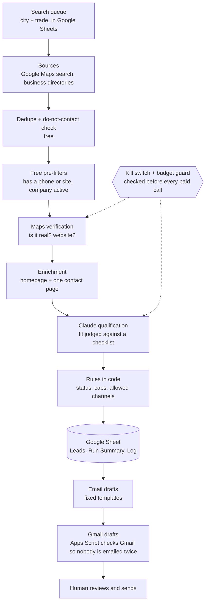

# Architecture

## Design choices

1. **Every outside service is passed in.** Maps, Claude, Google Sheets and the page fetcher are injected, so the
   whole pipeline runs on fakes in tests and in dry runs.
2. **Free first, paid last.** Duplicate checks and simple filters cost nothing; Maps lookups cost a fraction of a
   cent; the Claude call is the most expensive step, so it only runs on businesses that survive everything else.
3. **One business failing never stops the run.** Retryable errors (timeouts, rate limits) are retried on a later run,
   and only error types are logged, never raw error text or personal data.
4. **Idempotent.** Each business gets a key, so re-running a city does not create duplicates or spend twice.
5. **Batched writes.** Rows are written to the sheet in one append per tab at the end of each stretch of work.
6. **Run Summary per market.** Each run logs candidates seen, keeps, rejects, Claude tokens, search credits,
   estimated dollars and cost per lead, so cost per lead can be tracked over time.

## GitHub Actions workflows

| Workflow | Purpose |
|---|---|
| Leadgen run | Manual run: pick a mode and a limit, type a confirm phrase for live mode |
| Leadgen scheduled run | Weekday run on a timetable (can be switched off) |
| Email drafts | Writes outreach drafts after each run |
| Health check | Checks keys, sheet layout, sources and the kill switch; reports OK / WARN / FAIL |
| Qualification check | Tests the AI's judgement on a fixed set of sample businesses before a model or prompt change |
| Google check / write check | Confirms the Google connection and sheet access without changing real data |
