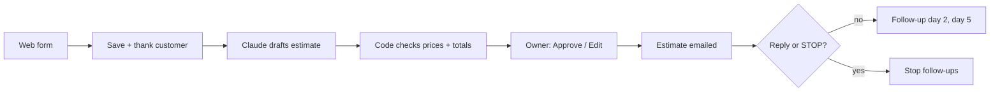

# Agent Forge: Quote Agent for Trades Businesses

An AI agent that turns a website enquiry into a priced estimate the same day, gets the owner's approval,
sends it, and follows up until the customer answers. Built for small electrician and solar firms by
**Pelumi, Founder, Agent Forge**.

> This is a **portfolio copy**. It shows the structure of the agent: folder layout and the names of its functions.
> Every function body, prompt, setting, price list, test and piece of data has been removed, so nothing here can run.

## The problem

Small trades firms lose jobs they have already won the enquiry for. The owner is on a roof or in a loft all day,
the quote goes out three days later, and nobody chases it. By then the customer has booked someone else.

## What it does

| Step | What happens |
|---|---|
| 1. Enquiry | A homeowner fills in a short web form: contact details, address, job type, size, photos and timing |
| 2. Acknowledge | They get an instant "we've got your request" email |
| 3. Draft | Claude drafts the estimate using **only** the business's own price list, kept in a Google Sheet |
| 4. Check | Plain code removes any item not on the price list, resets every price to the sheet's figure and adds up the totals itself |
| 5. Approve | The owner gets an email with **Approve and send** and **Edit** buttons |
| 6. Send | The customer gets a clean estimate email |
| 7. Follow up | If the customer goes quiet, a short follow-up goes out after 2 days and another after 5 |
| 8. Stop | Follow-ups stop as soon as the customer replies or says STOP |

See [docs/architecture.md](docs/architecture.md) for how the pieces fit together.

## Built-in safety

- **Owner approves every price.** Nothing with a price reaches a customer until the owner presses Approve.
- **The model cannot invent prices.** Claude returns structured JSON; code keeps only items on the price list, uses the sheet's prices and does the maths.
- **Asks instead of guessing.** If the enquiry is missing something, the draft lists questions for the owner rather than filling gaps.
- **Respects the customer.** Any reply, or the word STOP, ends the follow-ups.
- **Secrets stay out of the code.** The API key lives in the platform's secure script settings, never in the sheet or the file.
- **Safe to retry.** Drafts that fail (outage, no credit) are retried on the next timer run without double-sending.
- **Everything is logged.** Every email sent and every error is written to a log tab.

## Tech stack

Google Apps Script · Google Sheets · Gmail · Claude API (Haiku, structured output) · Tally forms · Node.js offline tests

## What is in this repo

| Path | What it is |
|---|---|
| `apps-script/Code.gs` | Skeleton of the agent: section and function names only, every body removed |
| `docs/architecture.md` | The two flows, the sheet layout and the quote lifecycle |

**Contact:** agentforgehq.studio@gmail.com · https://agentforgehq.netlify.app

© 2026 Agent Forge. All rights reserved. Shared for viewing only.
