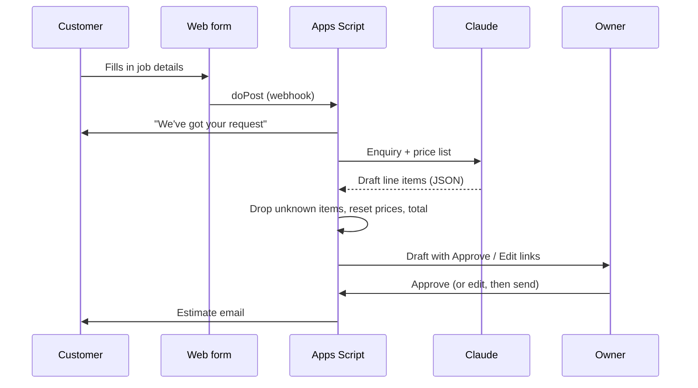
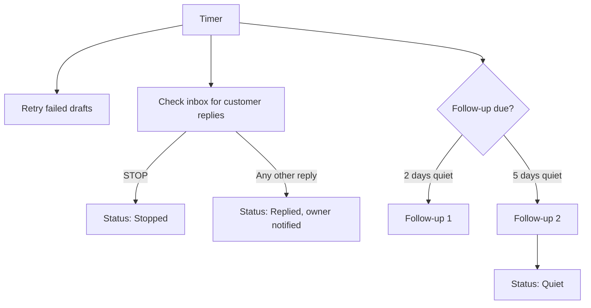

# Quote Agent: Architecture

The whole agent is one Google Apps Script file bound to one Google Sheet. There is no server to run:
the script is deployed as a web app (to receive form posts and owner clicks) and a timer runs it every 5 minutes.

## Pieces

| Piece | Role |
|---|---|
| Web form | Collects the enquiry and posts it to the script's web app link |
| Google Sheet | The database and the admin screen, one tab per kind of record |
| Apps Script web app | `doPost` takes enquiries; `doGet` serves the owner's Approve and Edit pages |
| Claude API | Drafts the estimate as structured JSON from the enquiry and the price list |
| Gmail | Sends the acknowledgement, owner, estimate and follow-up emails, and is checked for replies |
| 5-minute timer | Retries stuck drafts, watches for replies and STOP, sends due follow-ups |

## Sheet tabs

| Tab | Holds |
|---|---|
| Profiles | One row per business: name, trade, tone, currency, owner contact, follow-up timing |
| PriceList | Each business's items with low and high prices |
| Quotes | One row per enquiry, with its status and every timestamp |
| Log | Every email sent and every error |
| TestCases | Sample jobs used to check the drafting prompt without sending email |

Columns are found by header name, so the owner can reorder them freely. One sheet can serve several businesses.

## Flow A: enquiry to sent estimate

## Flow B: replies and follow-ups (every 5 minutes)

## Quote lifecycle

`New` → `Drafted` (or `Needs info` → `Info requested`) → `Sent` → `Follow-up 1` → `Follow-up 2` → `Quiet`,
with `Replied`, `Stopped` and `Error` reachable along the way. Each status change is stamped on the quote's row.

## Testing

The real build has offline tests that fake Google's services and the Claude API, so the full flow
(intake, drafting, price checks, approval, replies, STOP and follow-ups) runs with no network calls.
They are not included in this copy.
