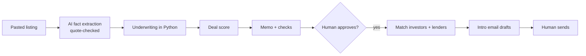

# Real Estate Referral Agent

An AI agent for real estate deal referral. A person pastes a property listing; the agent pulls out the facts,
runs the numbers, scores the deal, writes a checked deal memo, and matches approved deals with investors and
lenders who have agreed to hear about them. It drafts intro emails but never sends anything itself.
Built by **Agent Forge**.

> This is a **portfolio copy**. It shows the structure of the agent: folder layout and the names of its modules, classes and functions.
> Every function body, prompt, setting, test and piece of data has been removed, so nothing here can run.

## What it does

| Step | What happens |
|---|---|
| 1. Intake | Claude extracts listing facts, each tied to the exact words it came from; anything not found word for word becomes a gap, never a guess |
| 2. Comps | Recent sales and rentals nearby are entered |
| 3. Numbers | Python computes after-repair value, repairs, costs, max offer, rent, cap rate, cash flow and DSCR, with a "show the working" view |
| 4. Score | Six pass/fail checks; a deal is kept only if all pass |
| 5. Memo | Python writes every number; AI writes only the summary and risks; the memo fails if any number is not in the records or if fair-housing words appear |
| 6. Investors | Only people who opted in, with proof of funds and a clear buy box; opt-outs block all contact |
| 7. Matching | Deals matched to buy boxes; a match clears only under a signed agreement allowed in that state |
| 8. Lenders | Business-purpose lenders; investor details shared only with consent |
| 9. Pipeline | Deal status, fees, outcomes, tuning proposals and a weekly report |

## Built-in safety

- Test, paper and live modes; nothing is sent by code in any mode.
- No scraping: listings are pasted by hand.
- No invented numbers: every figure comes from tested Python code.
- Consent and opt-out records for every investor and lender.
- Fair-housing word list plus an AI check on memos and emails.
- Legal gate: no match clears until a state's rules are confirmed.
- Spend tracker on every paid AI call.

## Tech stack

Python 3.11 · Claude API · Streamlit dashboard · Google Sheets API · pydantic · pytest · GitHub Actions

**Contact:** agentforgehq.studio@gmail.com · https://agentforgehq.netlify.app

© 2026 Agent Forge. All rights reserved. Shared for viewing only.
