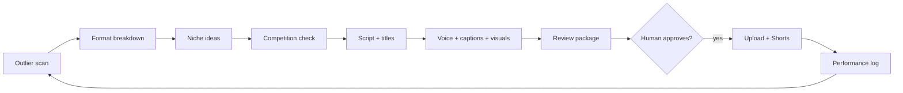

# Social Media Automation Agent

An AI agent that finds video formats that are already working on YouTube, turns them into original commentary
videos and Shorts for a fiction-fan channel, and prepares each one for a human to approve. It never publishes,
schedules or spends money on its own. Built by **Pelumi, Founder, Agent Forge**.

> This is a **portfolio copy**. It shows the structure of the agent: folder layout and the names of its modules, classes and functions.
> Every function body, prompt, setting, test and piece of data has been removed, so nothing here can run.

## What it does

| Stage | Jobs |
|---|---|
| A. Format scout | Finds outlier videos (views far above the channel's normal), breaks down why their titles and thumbnails work, adapts the format to the niche, checks competition and demand |
| B. Production | Writes an original script, scores title options, writes a thumbnail brief, records narration, times captions, assembles visuals, bundles a review package |
| C. Shorts | Picks 2 to 3 strong moments, reframes them to 9:16, writes captions and hashtags per platform |
| D. Learning loop | Logs views, click-through and watch time per format and flags formats that stop working |

## Built-in safety

- Propose only: every upload needs a human approval; paid steps need a typed approval phrase.
- Resumable: a manifest records each finished step and file hash, so a rerun only redoes what changed.
- Original content only: no reposting or clipping other creators' videos; AI voice is flagged for platform disclosure.
- Keys only in environment variables, never in the repo.

## Tech stack

Python 3.11 · Claude API · YouTube Data API · text-to-speech · Pillow · pytest · GitHub Actions

**Contact:** agentforgehq.studio@gmail.com · https://agentforgehq.netlify.app

© 2026 Agent Forge. All rights reserved. Shared for viewing only.
